# 🔄 Transaction Isolation in PostgreSQL

A practical demonstration of ACID transaction properties using the **social_media** database.

---

## 1. Atomicity

**Atomicity** ensures that all the steps within a transaction either execute successfully as a single indivisible unit, or if any single step fails, the entire transaction is rolled back so that no partial changes are ever applied.

### Example


---

#  Types of Reads

---

## 1. Dirty Read

A **Dirty Read** occurs when one database transaction reads data that has been modified by another concurrent transaction, but those changes have not yet been committed. This means the reading transaction might act on data that could later be rolled back, leading to incorrect or inconsistent results.


---

## 2. Read Committed

The **Read Committed** isolation level is a standard database setting that ensures a transaction only reads data that has been fully committed by other transactions. This prevents dirty reads, guaranteeing that any data a transaction sees has been permanently saved by another transaction.


---

## 3. Repeatable Read

A **Repeatable Read** is a database isolation level that guarantees a transaction will always read the exact same data during its execution, even if another transaction modifies or deletes that data. Once a row is read within a transaction, subsequent reads of the same row will return the same values.


---

## 4. Serializable

In the **Serializable** isolation level, when a database executes transactions under this level, it guarantees that concurrent transactions behave as if they were executed one after another (serially) in a single, orderly sequence. This is the strictest isolation level, providing complete protection against all concurrency anomalies.


---


## Transaction Isolation Levels

The following table summarizes which concurrency anomalies are possible at each isolation level in PostgreSQL:

| Isolation Level | Dirty Read | Nonrepeatable Read | Phantom Read | Serialization Anomaly |
|---|---|---|---|---|
| Read uncommitted | Allowed, but not in PG | Possible | Possible | Possible |
| Read committed | Not possible | Possible | Possible | Possible |
| Repeatable read | Not possible | Not possible | Allowed, but not in PG | Possible |
| Serializable | Not possible | Not possible | Not possible | Not possible |

---

#  Read Committed Isolation

The **Read Committed** is a database isolation level(default in Postgres) that ensures a transaction only reads data that has been fully committed by other transactions. This prevents dirty reads, guaranteeing that any data a transaction sees has been permanently saved by another transaction.

---

## Non Repeatable Read Example


### Step 1 — Transaction A reads the data

Transaction A begins with `READ COMMITTED` isolation level and reads the comment with `post_id = 1`. The content is **"Good post"**.

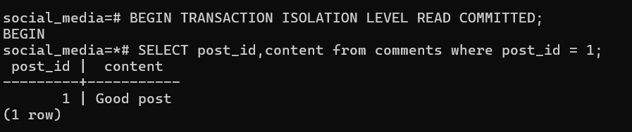

### Step 2 — Transaction B modifies and commits the data

Meanwhile, a separate Transaction B begins, updates the same comment's content to **"This is a nice post"**, and commits the change.

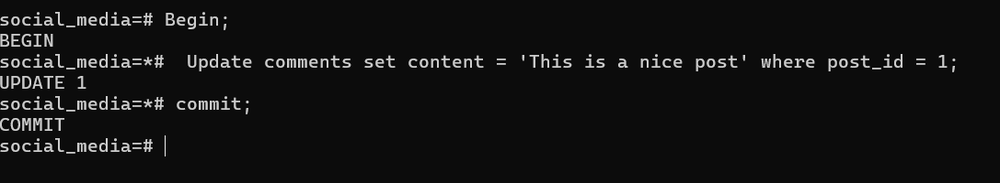

### Step 3 — Transaction A re-reads and gets different data

Transaction A runs the **same SELECT query** again, but this time it reads **"This is a nice post"** instead of the original **"Good post"** — a different result for the same query within the same transaction!

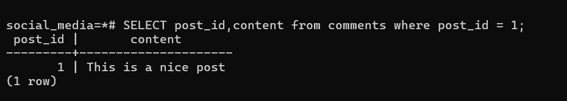


---

## Phantom Read Example


### Step 1 — Transaction A reads all shares

Transaction A begins and runs `SELECT * FROM shares`, returning **10 rows** of data. The row with `post_id = 5` (user_id 3) is present.

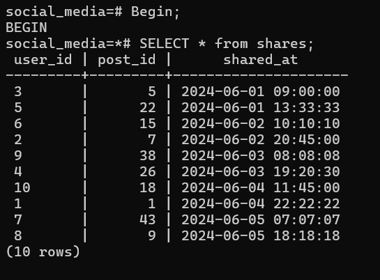

### Step 2 — Transaction B deletes a row and commits

A separate Transaction B begins, deletes the share where `post_id = 5`, and commits the change. The row is now permanently removed from the table.

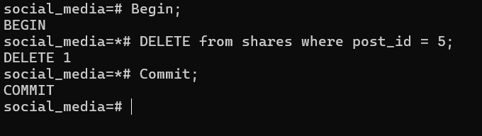

### Step 3 — Transaction A re-reads and a row has vanished

Transaction A runs the **same `SELECT * FROM shares`** query again. This time it returns only **9 rows** — the row with `post_id = 5` has disappeared! A row that existed during the first read is now gone.

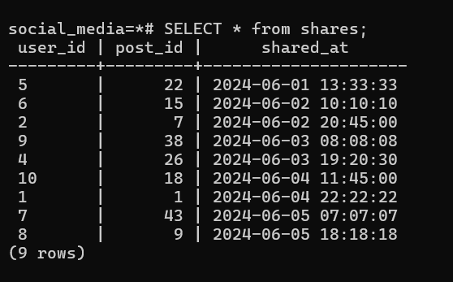


---

## Serializable Example


### Step 1 — Transaction A updates and commits

Transaction A begins, updates the comment with `post_id = 12` to **"Nice post"**, and commits the change.

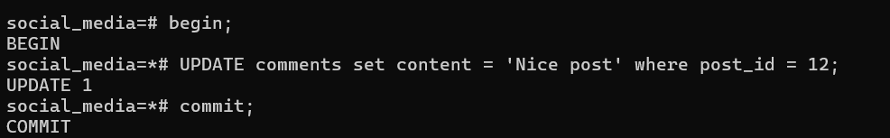

### Step 2 — Transaction B updates and commits

Transaction B begins, updates the same comment (`post_id = 12`) to **"Great post"**, and commits the change. Since Transaction A has already committed, Transaction B executes serially after it.

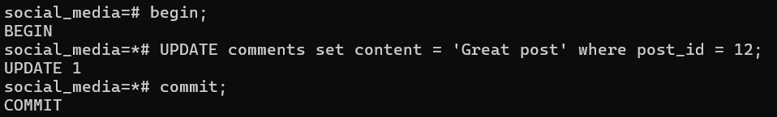

### Step 3 — Final state reflects serial execution

A `SELECT` query confirms that the final value is **"Great post"** — the result of Transaction B, which was the last to commit. The database maintained a consistent serial order: Transaction A ran first, then Transaction B overwrote the value.

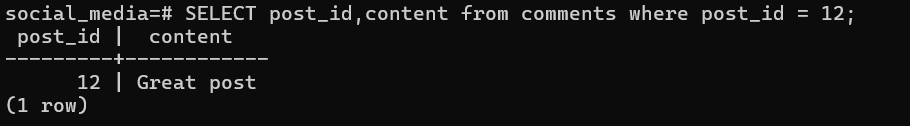


---

#  Repeatable Read Isolation 

A **Repeatable Read** is a database isolation level(default in MySQL) that guarantees a transaction will always read the exact same data during its execution, even if another transaction modifies or deletes that data. Once a row is read within a transaction, subsequent reads of the same row will return the same values.

---

## Non Repeatable Read Example (Prevented)


### Step 1 — Transaction A reads the data under Repeatable Read

Transaction A begins with `REPEATABLE READ` isolation level and reads the comment with `post_id = 1`. The content is **"This is a nice post"**.

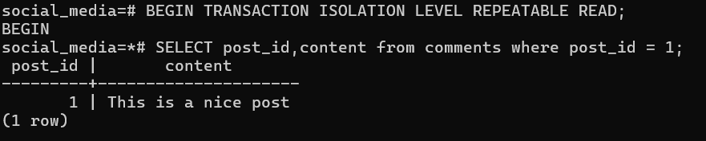

### Step 2 — Transaction B modifies and commits the data

A separate Transaction B begins, updates the same comment's content to **"Great post"**, and commits the change.

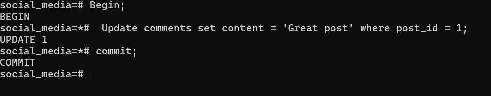

### Step 3 — Transaction A re-reads and sees the SAME data

Transaction A runs the **same SELECT query** again. Despite Transaction B having committed **"Great post"**, Transaction A still sees **"This is a nice post"** — the original value from its snapshot. The non-repeatable read is **prevented**!

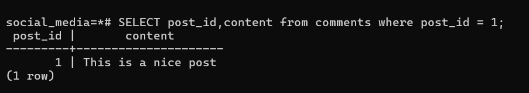


---

## Phantom Read Example (Prevented)


### Step 1 — Transaction A reads all shares under Repeatable Read

Transaction A begins with `REPEATABLE READ` isolation level and runs `SELECT * FROM shares`, returning **9 rows**. The row with `post_id = 7` (user_id 2) is present.

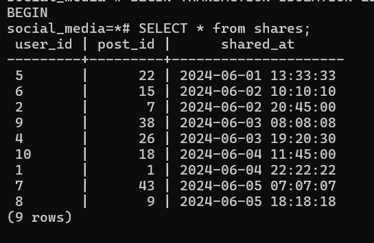

### Step 2 — Transaction B deletes a row and commits

A separate Transaction B begins, deletes the share where `post_id = 7`, and commits the change. The row is now permanently removed from the table.

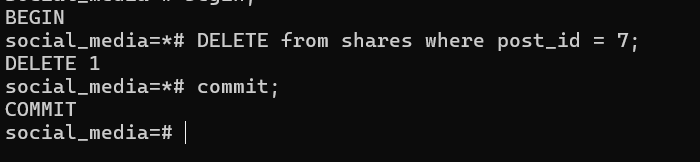

### Step 3 — Transaction A re-reads and still sees the SAME rows

Transaction A runs the **same `SELECT * FROM shares`** query again. Despite Transaction B having deleted and committed, Transaction A still sees **9 rows** — including the row with `post_id = 7`. The phantom read is **prevented**!


---

## Serializable

The **Serializable** isolation level behaves the same as **Read Committed** isolation in this context. Since Serializable is the strictest level, it inherently provides all the guarantees of Repeatable Read (and more), meaning non-repeatable reads and phantom reads are already prevented. The key difference is that Serializable additionally detects and prevents **serialization anomalies** — conflicts that could arise when concurrent transactions produce results inconsistent with any serial execution order.

---

#  Serializable Isolation

---

## Non Repeatable Read Example (Prevented)

This example demonstrates how the **Serializable** isolation level prevents the non-repeatable read anomaly — just like Repeatable Read, but with the additional guarantee of full serializability.

### Step 1 — Transaction A reads the data under Serializable

Transaction A begins with `SERIALIZABLE` isolation level and reads the comment with `post_id = 1`. The content is **"Great post"**.

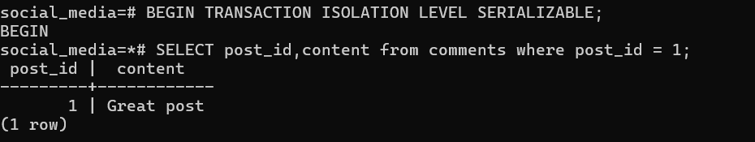

### Step 2 — Transaction B modifies and commits the data

A separate Transaction B begins, updates the same comment's content to **"A very nice post"**, and commits the change.

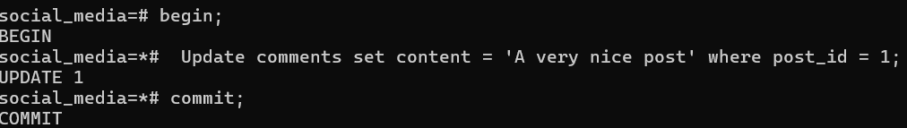

### Step 3 — Transaction A re-reads and sees the SAME data

Transaction A runs the **same SELECT query** again. Despite Transaction B having committed **"A very nice post"**, Transaction A still sees **"Great post"** — the original value from its snapshot. The non-repeatable read is **prevented**!

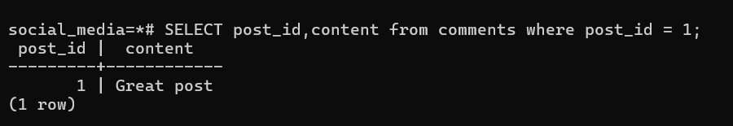

> **Key Takeaway:** Under **Serializable** isolation, PostgreSQL provides the strongest consistency guarantee. Like Repeatable Read, it uses a snapshot to prevent non-repeatable reads and phantom reads. Additionally, it monitors for serialization anomalies and will abort a transaction if it detects that concurrent execution would produce results impossible under any serial ordering.

---

## Phantom Read Example (Prevented)

This example demonstrates how the **Serializable** isolation level prevents phantom reads. Even after another transaction deletes a row and commits, the original transaction continues to see the same set of rows.

### Step 1 — Transaction A reads all shares under Serializable

Transaction A begins with `SERIALIZABLE` isolation level and runs `SELECT * FROM shares`, returning **8 rows**. The row with `post_id = 22` (user_id 5) is present.


### Step 2 — Transaction B deletes a row and commits

A separate Transaction B begins, deletes the share where `post_id = 22`, and commits the change. The row is now permanently removed from the table.

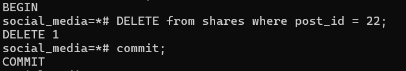

### Step 3 — Transaction A re-reads and still sees the SAME rows

Transaction A runs the **same `SELECT * FROM shares`** query again. Despite Transaction B having deleted and committed, Transaction A still sees **8 rows** — including the row with `post_id = 22`. The phantom read is **prevented**!

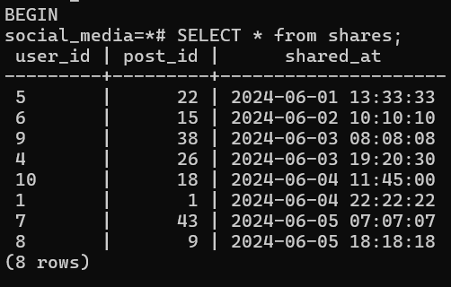

> **Key Takeaway:** Under **Serializable** isolation, PostgreSQL guarantees the strongest level of consistency. The transaction's snapshot remains completely isolated from any concurrent modifications — no dirty reads, no non-repeatable reads, and no phantom reads. If any serialization conflict is detected, PostgreSQL will abort one of the conflicting transactions rather than allow inconsistent results.

---

## Serialization Anomaly (Prevented)


### Step 1 — Transaction A updates a row (not yet committed)

Transaction A begins with `SERIALIZABLE` isolation level and updates the comment with `post_id = 1` to **"A very nice post"**. The transaction is still open — it has **not committed yet**.

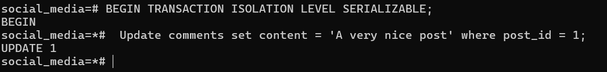

### Step 2 — Transaction B tries to update the same row

Transaction B also begins with `SERIALIZABLE` isolation level and attempts to update the same row (`post_id = 1`) to **"Great post"**. PostgreSQL detects a serialization conflict and **rejects** the operation with the error:

```
ERROR: could not serialize access due to concurrent update
```

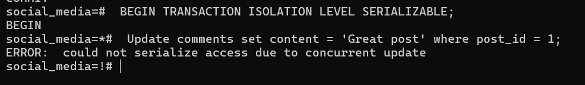


